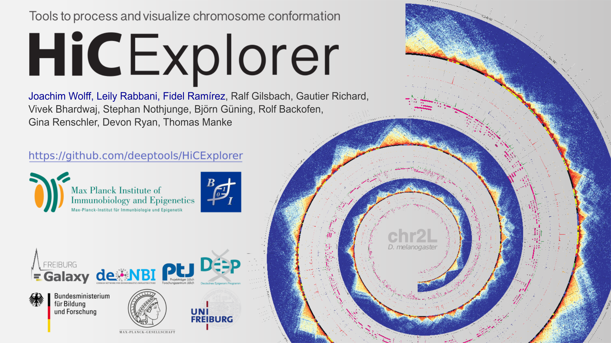

|cpp| |python| |rtd| |conda| |docker| |galaxy|

.. |cpp| image:: https://github.com/deeptools/HiCExplorer/actions/workflows/cpp.yml/badge.svg?branch=version4-cpp
   :target: https://github.com/deeptools/HiCExplorer/actions/workflows/cpp.yml
.. |python| image:: https://github.com/deeptools/HiCExplorer/actions/workflows/python.yml/badge.svg?branch=version4-cpp
   :target: https://github.com/deeptools/HiCExplorer/actions/workflows/python.yml
.. |rtd| image:: https://readthedocs.org/projects/hicexplorer/badge/?version=latest
   :target: http://hicexplorer.readthedocs.io/?badge=latest
.. |conda| image:: https://anaconda.org/bioconda/hicexplorer/badges/installer/conda.svg
   :target: https://anaconda.org/bioconda/hicexplorer
.. |galaxy| image:: https://img.shields.io/badge/usegalaxy-.eu-brightgreen?logo=
   :target: https://usegalaxy.eu/root?tool_id=hicexplorer_hicplotviewpoint
.. |docker| image:: https://quay.io/repository/biocontainers/hicexplorer/status
   :target: https://quay.io/repository/biocontainers/hicexplorer

HiCExplorer
===========

Set of programs to process, analyze and visualize Hi-C, Micro-C and cHi-C data
------------------------------------------------------------------------------

Sequencing techniques that probe the 3D organization of the genome generate large amounts of data whose processing,
analysis and visualization is challenging. HiCExplorer is a set of tools for the analysis and visualization of
chromosome conformation data. It builds contact matrices from Hi-C, Micro-C and capture Hi-C reads, corrects them,
checks their quality and reproducibility, calls domains, loops, compartments and stripes, compares conditions, scores
capture Hi-C interactions and converts between the cool, mcool, h5 and .hic formats. It visualizes contact matrices
together with genes, ChIP-seq coverage and other genomic tracks, long-range contacts and viewpoints.

HiCExplorer 4.0
---------------

HiCExplorer 4.0 (November 2026) keeps the names, command lines, file formats and outputs of every tool of 3.7.6 and
the Python API, and runs them on a new compiled core. On real data it computes the results of 3.7.6 two to ten times
faster with two to four times less memory, and most tools run multithreaded (``--threads``):

==========================================  ============  ============  =======  =================
Task                                        3.7.6         4.0           Speedup  Peak memory
==========================================  ============  ============  =======  =================
hicBuildMatrix, 92.7M reads, 10 kb          42 min 18 s   16 min 22 s   2.6x     14.9 GB to 6.1 GB
hicDetectLoops, GM12878 chr1, 10 kb         20.6 s        2.1 s         10.0x    624 MB to 230 MB
hicFindTADs, GM12878 chr1, 10 kb            33.0 s        6.3 s         5.2x     6.0 GB to 1.5 GB
hicPCA, GM12878 chr1, 100 kb                24.2 s        3.8 s         6.4x     493 MB to 147 MB
==========================================  ============  ============  =======  =================

Version 4 adds new methods, each giving the results of its reference software, also faster than that software:

===============================================  ==========================  ===================  ==================
Task                                             Reference software          Reference            HiCExplorer 4.0
===============================================  ==========================  ===================  ==================
CHiCAGO scores, 22,076 baits                     R CHiCAGO 1.38.0            437.5 s, 40.4 GB     48.5 s, 3.9 GB
Stripes, 22 GM12878 autosomes, 10 kb             Stripenn 1.1.65.22          3,015 s, 7.2 GB      210 s, 2.2 GB
.hic to cool, GM12878 at 25 kb                   hic2cool 1.0.1              1,951 s, 5.3 GB      162 s, 0.5 GB
===============================================  ==========================  ===================  ==================

New in version 4:

- **Capture Hi-C with CHiCAGO**: ``chicChicagoBackgroundModel``, ``chicChicagoScores``,
  ``chicChicagoSignificantInteractions`` and ``chicChicagoPlotViewpoint`` call the same interactions as R CHiCAGO,
  from CHiCAGO's input files or directly from contact matrices.
- **Domains**: ``hicArrowhead`` (the Arrowhead algorithm of Juicer tools), nested domains and a CTCF motif filter
  in ``hicFindTADs``.
- **Stripes**: ``hicDetectStripes`` calls the same stripes as Stripenn.
- **Differential analysis**: ``hicDifferentialAnalysis`` tests domains, loops and compartments between conditions
  with replicates.
- **Quality control**: ``hicMatrixQC`` reports on finished cool and mcool matrices, and ``hicCorrelate`` computes
  the reproducibility measures SCC, GenomeDISCO, HiC-Spector, QuASAR-Rep and ENT3C.
- **Formats**: ``hicConvertFormat`` reads .hic files of versions 6 to 9 and writes versions 8 and 9, and
  ``hicBuildMatrix`` reads the 4DN .pairs format.

The full list is in the `release notes <https://hicexplorer.readthedocs.io/en/latest/news/>`_, and the data and
all measurements are on the `benchmarks page <https://hicexplorer.readthedocs.io/en/latest/benchmarks/>`_.

Single-cell Hi-C data
---------------------

We provide the scHiCExplorer to create, manipulate, analyse and visualize single-cell Hi-C data in its own software:
The  `scHiCExplorer <https://github.com/joachimwolff/schicexplorer>`_.

Citation:
^^^^^^^^^

Joachim Wolff, Rolf Backofen, Björn Grüning.
**Loop detection using Hi-C data with HiCExplorer**, GigaScience, Volume 11, 2022, giac061, https://doi.org/10.1093/gigascience/giac061

Joachim Wolff, Leily Rabbani, Ralf Gilsbach, Gautier Richard, Thomas Manke, Rolf Backofen, Björn A Grüning.
**Galaxy HiCExplorer 3: a web server for reproducible Hi-C, capture Hi-C and single-cell Hi-C data analysis, quality control and visualization, Nucleic Acids Research**, Nucleic Acids Research, Volume 48, Issue W1, 02 July 2020, Pages W177–W184, https://doi.org/10.1093/nar/gkaa220

Joachim Wolff, Vivek Bhardwaj, Stephan Nothjunge, Gautier Richard, Gina Renschler, Ralf Gilsbach, Thomas Manke, Rolf Backofen, Fidel Ramírez, Björn A Grüning. 
**"Galaxy HiCExplorer: a web server for reproducible Hi-C data analysis, quality control and visualization", Nucleic Acids Research**, Volume 46, Issue W1, 2 July 2018, Pages W11–W16, doi: https://doi.org/10.1093/nar/gky504

Fidel Ramirez, Vivek Bhardwaj, Jose Villaveces, Laura Arrigoni, Bjoern A Gruening, Kin Chung Lam, Bianca Habermann, Asifa Akhtar, Thomas Manke.
**"High-resolution TADs reveal DNA sequences underlying genome organization in flies". Nature Communications**, Volume 9, Article number: 189 (2018), doi: https://doi.org/10.1038/s41467-017-02525-w

Availability
^^^^^^^^^^^^

HiCExplorer is available as a **command line suite of tools** on this very GitHub repository and also on other platforms (detailed in *Installation* below).

A **Galaxy HiCExplorer version** is directly available to users at http://hicexplorer.usegalaxy.eu. Training material is available at the `Galaxy Training Network <http://galaxyproject.github.io/training-material/topics/epigenetics/tutorials/hicexplorer/tutorial.html>`_,
while a Galaxy Tour is available `here <https://hicexplorer.usegalaxy.eu/tours/hixexplorer>`_ for users not familiar with this platform. Galaxy HiCExplorer is also available as a Docker image at the `Docker Galaxy HiCExplorer GitHub repository <https://github.com/deeptools/docker-galaxy-hicexplorer>`_. Finally, this Galaxy version is available on the `Galaxy Tool Shed <https://toolshed.g2.bx.psu.edu/>`_ and on the corresponding `GitHub repository <https://github.com/galaxyproject/tools-iuc>`_.

Installation
^^^^^^^^^^^^

HiCExplorer runs on Linux (x86_64 and arm64) and macOS (arm64). We recommend installing it with conda from
`Bioconda <http://bioconda.github.io/>`_:

::

   $ conda create --name hicexplorer -c conda-forge -c bioconda hicexplorer=4.0
   $ conda activate hicexplorer

The package contains the command-line tools and the Python API. To learn more about conda environments, see the
`conda documentation <https://docs.conda.io/projects/conda/en/latest/user-guide/getting-started.html>`_.

Build from source
_________________

Building from source needs a C++20 compiler, CMake 3.24 or newer and the native libraries listed in
`cpp/BUILDING.md <cpp/BUILDING.md>`_, most easily taken from a conda environment:

::

    $ git clone https://github.com/deeptools/HiCExplorer.git
    $ cd HiCExplorer
    $ pip install .

The `installation documentation <https://hicexplorer.readthedocs.io/en/latest/installation/>`_ describes the
details.

Galaxy version
++++++++++++++

Install with Docker
___________________

Installation instructions as a Docker image can be followed at https://github.com/deeptools/docker-galaxy-hicexplorer.

Install with Tool Shed
______________________

Galaxy HiCExplorer is part of the `Galaxy Tool Shed <https://toolshed.g2.bx.psu.edu/>`_ and can be installed from there to any Galaxy server following `this link <https://toolshed.g2.bx.psu.edu/repository/browse_repository?id=f1554978eeb3da8b>`_.

Documentation:
^^^^^^^^^^^^^^
Please visit our complete documentation `Here <http://hicexplorer.readthedocs.org/>`_. This documentation is also available directly within `Galaxy <http://hicexplorer.usegalaxy.eu/>`_.
