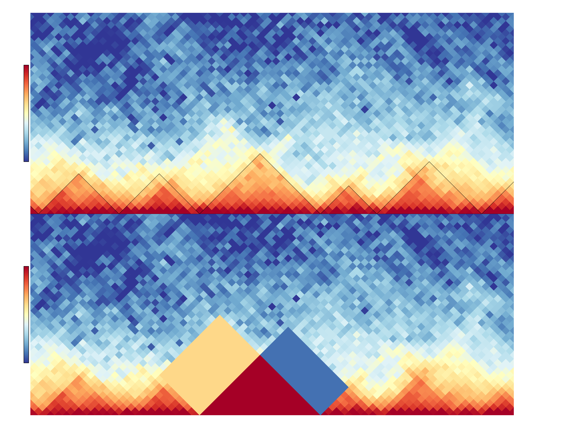

# hicDifferentialTAD

Identifies differential TADs between two Hi-C matrices.

```text
usage: hicDifferentialTAD [--targetMatrix TARGETMATRIX]
                          [--controlMatrix CONTROLMATRIX]
                          [--tadDomains TADDOMAINS]
                          [--outFileNamePrefix OUTFILENAMEPREFIX]
                          [--pValue PVALUE]
                          [--mode {intra-TAD,left-inter-TAD,right-inter-TAD,all}]
                          [--modeReject {all,one}] [--threads THREADS]
                          [--sharedMask]
                          [--correctForMultipleTesting {none,fdr,bonferroni}]
                          [--help] [--version]
```

Computes differential TADs by comparing the precomputed TAD regions of the target matrix with the same regions of the control matrix. Please notice that the matrices need to have the same read coverage, this can be achieved with hicNormalize and the 'smallest'-mode. H0 is the assumption that two regions are identical, the rejected files contain therefore the as differential considered regions.

## Required arguments

| Flag | Meaning |
|---|---|
| `--targetMatrix TARGETMATRIX, -tm TARGETMATRIX` | The target matrix: the first of the two compared matrices. The TAD domains should be computed from it, or from the control matrix. |
| `--controlMatrix CONTROLMATRIX, -cm CONTROLMATRIX` | The control matrix to test the TADs for a differential interaction pattern. |
| `--tadDomains TADDOMAINS, -td TADDOMAINS` | The TADs domain file computed by hicFindTADs. Its domains define the regions that are compared between the two matrices; they are not tested for being TADs. Compute them with hicFindTADs from the target matrix, or from the matrix of the condition whose domains should be tested in the other (usually the control). |
| `--outFileNamePrefix OUTFILENAMEPREFIX, -o OUTFILENAMEPREFIX` | Outfile name prefix to store the accepted / rejected H0 TADs. |

## Optional arguments

| Flag | Meaning |
|---|---|
| `--pValue PVALUE, -p PVALUE` | H0 is considered as 'two regions are identical.' i.e. all regions with a test result of <= p-value are rejected and considered as differential (Default: 0.05). |
| `--mode {intra-TAD,left-inter-TAD,right-inter-TAD,all}, -m {intra-TAD,left-inter-TAD,right-inter-TAD,all}` | Consider only intra-TAD interactions, or additional left inter-TAD, right inter-TAD or all (Default: all). |
| `--modeReject {all,one}, -mr {all,one}` | All test of a mode must be rejected (all) or reject region (and accept it is differential) as soon as at least one region is having a p-value <= --pValue (Default: one). |
| `--threads THREADS, -t THREADS` | Number of threads to use, the parallelization is implemented per chromosome (Default: 4). |
| `--sharedMask` | Before any test, mask in both matrices every bin that is invalid in either of them: the NaN bins after loading, for a cool file the bins whose row is all zero. New in HiCExplorer 4; without it the output is that of HiCExplorer 3. |
| `--correctForMultipleTesting {none,fdr,bonferroni}` | Adjust the p-values of each test across all TADs, Benjamini-Hochberg (fdr) or Bonferroni, and apply --pValue to the adjusted values; the output files gain the adjusted p-values. New in HiCExplorer 4 (Default: none). |
| `--help, -h` | show this help message and exit |
| `--version` | show program's version number and exit |

## Notes

hicDifferentialTAD takes a target Hi-C matrix, a control Hi-C matrix and a precomputed TAD domains file, and tests for every domain whether the contacts differ between the two matrices.
The domains must be computed with hicFindTADs; they define the coordinates of the regions that are compared, the same coordinates are read from both matrices. Compute them from the matrix in which the domain structure is the reference of interest. This is the target matrix, or the control matrix when the question is whether the domains of the control are changed in the target. Domains computed from a third matrix, for example a merged one, are also valid. Both matrices must be on the same bins.

hicDifferentialTAD extract per TAD three regions: the intra-TAD, the left and right inter-TAD region. In the following image, the upper visualization shows a region with the
detected TADs which are indicated by the black lines. The bottom shows as an example which regions are used for the differential test: the intra-TAD region is highlighted in red,
the left inter-TAD in sandy-color and the right inter-TAD in blue. Between two samples a Wilcoxon rank-sum test is applied for a TAD under H0: 'The regions are equal'.
For all three regions of a TAD the rank-sum test is independently applied. The user has the choice with the two parameters 'mode' and 'modeReject' to define if a) all three
regions should be considered ('all'), or only a subset e.g. the intra-TAD or intra-TAD and left inter-TAD should be considered; and b) if all regions need to have lower p-value than the 
user given to reject H0 or if it is enough that at least one region is rejecting H0 to consider the region as differential.


### Example usage

```bash
$ hicDifferentialTAD -tm GSM2644945_Untreated-R1.100000_chr1.cool -cm GSM2644947_Auxin2days-R1.100000_chr1.cool -td untreated_R1_domains.bed -o differential -p 0.01 -t 4 -mr all
```
In this example the untreated matrix is the target (`-tm`) and the domains were computed with hicFindTADs from the same untreated matrix, so the domains of the untreated cells are tested for a change in the auxin-treated matrix (`-cm`). With the roles exchanged, the domains would be computed from the auxin-treated matrix. The roles of the two matrices also determine the sign of the statistic described below.

In this example data from Nora et al. "Targeted Degradation of CTCF Decouples Local Insulation of Chromosome Domains from Genomic Compartmentalization", Cell 169.5 (2017): 930-944 is used [GEO: https://www.ncbi.nlm.nih.gov/geo/query/acc.cgi?acc=GSE98671]


The output are two BED-similar files: the '_accepted.diff_tad' and '_rejected.diff_tad' file. The difference to a real BED file is the header of lines starting with '#'. The columns are:

| Column | Content |
|---|---|
| 1-6 | `Chromosome`, `start`, `end`, `name`, `score`, `strand`: BED6 fields copied from the domains file of hicFindTADs (the score is the TAD-separation score of that file). |
| 7 | `p-value left-inter-TAD`: p-value of the Wilcoxon rank-sum test on the contacts between the TAD and its left neighbour domain. |
| 8 | `p-value right-inter-TAD`: the same for the right neighbour domain. |
| 9 | `p-value intra-TAD`: the same for the contacts inside the TAD. |
| 10-12 | `W left-inter-TAD`, `W right-inter-TAD`, `W intra-TAD`: the test statistic of the three tests, in the same order. |
| 13-15 | `adjusted p-value left-inter-TAD`, `adjusted p-value right-inter-TAD`, `adjusted p-value intra-TAD`: only with `--correctForMultipleTesting` (not `none`); the p-values adjusted across all TADs, separately for each test. `--pValue` is then applied to these values. |

Each test compares the contacts of one region in the target matrix (first sample) with the contacts of the same region in the control matrix (second sample). All bin pairs of the region are ranked together, zeros included. The statistic W is the standardised rank sum of the target sample, that is its rank sum minus the expected value under H0, divided by the standard deviation, as in the normal approximation of the Wilcoxon rank-sum test; the p-value is two-sided. The sign gives the direction of the difference: W is positive when the contacts of the region are higher in the target matrix than in the control matrix, and negative when they are lower. W has no fold-change scale: its size depends on the number of bin pairs of the region, so it is not comparable between regions of different sizes. A region without a neighbour (the first or last domain of a chromosome for the left and right test) was not tested and shows `nan` in both its p-value and its W; such a test never rejects H0.

The p-values decide if the region is written to the rejected file (differential) according to `--mode`, `--modeReject` and `--pValue`. The file does not say which of the tests led to the rejection. Use the p-value columns for it, and the sign of W for the direction.

```bash
# Created with HiCExplorer's hicDifferentialTAD version 3.5-dev
# H0 'regions are equal' H0 is rejected for all p-value smaller or equal the user given p-value threshold; i.e. regions in this file are considered as differential.
# Rejected regions with Wilcoxon rank-sum test to p-value: 0.01  with used mode: all and modeReject: all 
# Chromosome	start	end	name	score	strand	p-value left-inter-TAD	p-value right-inter-TAD	p-value intra-TAD
chr1	4400000	6200000	ID_0.01_1	-0.5630275	.	nan	0.42772134044376386	0.0001942482956610518
chr1	6200000	7300000	ID_0.01_2	-0.235798	.	0.3479058102348157	0.651801360704674	0.011174626122333891
chr1	7300000	9500000	ID_0.01_3	-0.44334	.	0.7619708385959597	0.9408966423531526	4.668547072331386e-06
chr1	10100000	11600000	ID_0.01_5	-0.6844015	.	0.10355136240139871	0.2022260523997077	0.006197912102328514
chr1	11600000	12900000	ID_0.01_6	-0.607587	.	0.39564035674322084	0.04934747494654432	5.069275897797787e-07
chr1	12900000	13700000	ID_0.01_7	-0.6303795	.	0.030328896271663634	0.048097680638217614	0.0023999817017426378
chr1	13700000	14900000	ID_0.01_8	-1.2063985	.	0.07605786424686575	0.5322636852613494	1.8146100883843892e-06
chr1	14900000	17100000	ID_0.01_9	-0.3406565	.	0.4982863585572014	0.692745144471043	0.002562121461829293
chr1	17100000	18100000	ID_0.01_10	-0.230354	.	0.8237750360973404	0.011911117420279341	0.00020602838341698515
chr1	18100000	19100000	ID_0.01_11	-0.5135365	.	0.007089417650089524	0.07553560212368073	0.03561337274424189
```
